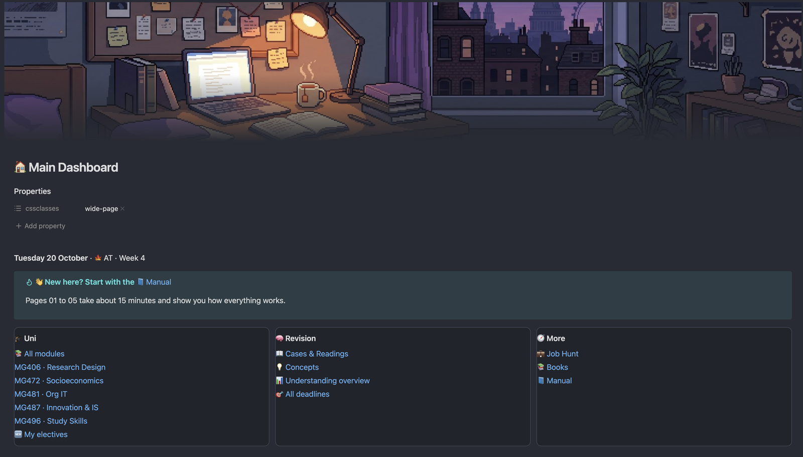

## The problem

On MISDI you have five modules at once, each with lectures, seminars, readings, cases and deadlines. Notes end up spread across Word documents, slides, the Notes app and Moodle. Then, before exams, it's hard to answer simple questions:

- Which topics do I actually understand, and which do I only *think* I understand?
- Which notes did I never finish?
- When is everything due?
- Where did I read that idea that would be perfect for my essay?

## What this vault does

| Without this vault | With this vault |
| --- | --- |
| Notes scattered across apps and folders | Every module has one folder and one dashboard |
| You guess what to revise | Every note has a rating (🔴 → 🟢), and dashboards list your weakest topics first |
| Deadlines live in five different Moodle pages | One countdown list of every deadline, colour-coded |
| Half-finished notes get forgotten | Notes still at "brief notes" stage are listed until you finish them |
| Ideas from one module stay in that module | Concepts and readings link across every module, so you can see connections |
| Job applications live in a spreadsheet you forget to update | A job tracker with deadlines and a drag-and-drop board |

> **In short:** you write the notes, and the vault does the organising.

This is NOAT's Main Dashboard, exactly as it looks when you first open it:

## Why Obsidian?

- **It's free**, and you don't need an account.
- **Your notes are files on your computer**, not on someone else's server. They work offline.
- **They're plain text**, so you'll still be able to open them in 10 years, with or without Obsidian.
- **Notes can link to each other**, which is what makes the dashboards and the [graph view](07%20Linking%20notes%20and%20the%20graph%20view.md) possible.

## Why concept notes help you learn

Rereading slides feels productive but doesn't stick very well. Explaining an idea **in your own words** does. Each concept note is one idea, written by you, with a question and a short answer, so it works like a flashcard you can always come back to. See [06 How the folders work together](06%20How%20the%20folders%20work%20together.md).

## What this vault isn't

- It's **not an official LSE tool**, and it doesn't connect to Moodle. Always check Moodle for official dates.
- It doesn't write notes for you. It just makes the notes you write far more useful.

---

⬅️ Previous: [00 Start here](00%20Start%20here.md) · [📘 Contents](00%20Start%20here.md) · Next: [02 Install and set up](02%20Install%20and%20set%20up.md) ➡️
