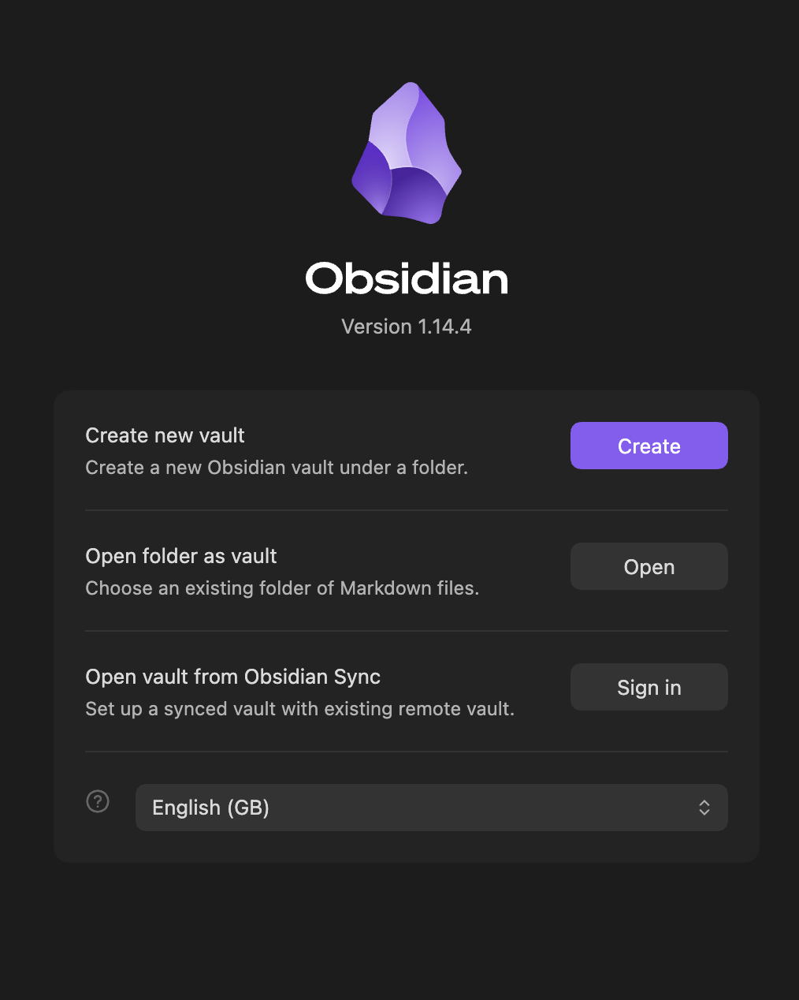

This takes about 5 minutes. You only do it once.

> If you're reading this inside Obsidian, you've already done steps 1 to 5. Skip to [03 Obsidian basics](03%20Obsidian%20basics.md).

## Step 1: Install Obsidian

Download Obsidian (free) from [obsidian.md/download](https://obsidian.md/download) and install it like any other app. You need **version 1.13 or newer**. A fresh download is always new enough.

## Step 2: Download NOAT from GitHub

GitHub is a website where people share projects. **You don't need an account** to download NOAT, and you don't need to understand the rest of the site.

> [!NOTE]
> These steps download a ZIP, which is the easiest way. If you'd like to learn a bit of git instead, see **Optional: get NOAT with git** further down this page, then skip to step 4.

1. Open NOAT's GitHub page (the link you were sent). You'll see a list of files and folders, with the README underneath.
2. Above that list, on the right, find the green **<> Code** button and click it.
3. In the menu that opens, click **Download ZIP** (at the bottom).
4. A file called `noat-main.zip` downloads, usually into your **Downloads** folder.

> [!TIP]
> Don't click on the individual files on GitHub to download them one by one. **Download ZIP** gets everything at once, including the hidden settings that make the dashboards work.

## Step 3: Unzip it and choose where to keep it

A ZIP file is a compressed folder, so first you need to unzip it:

| Mac | Windows |
| --- | --- |
| Double-click `noat-main.zip`. A folder called `noat-main` appears next to it | Right-click `noat-main.zip`, choose **Extract All…**, then click **Extract** |

Then move the `noat-main` folder to where you want your notes to live. You can rename it to anything, e.g. `MISDI Notes`. You can delete the ZIP file afterwards.

> [!TIP]
> On Windows, unzipping sometimes creates a folder inside a folder with the same name. The right folder is the one that contains `🏠 Main Dashboard.md`.

Don't leave it in Downloads, which is easy to clear by accident. Pick one of these:

| Where | Good for | One thing to set |
| --- | --- | --- |
| **On your computer** (e.g. Documents) | The simplest option. Works offline | Nothing, but your notes are only on that computer, so keep a backup |
| **iCloud Drive** | The best choice if you might want your notes on an iPhone or iPad later | On Mac, right-click the folder and choose **Keep Downloaded**, so your Mac doesn't move notes off the laptop to save space |
| **Google Drive** | If you already use Google Drive for everything | In Google Drive for desktop, make the folder **available offline**. Note that Obsidian on iPhone can't open vaults in Google Drive |

## Step 4: Open it in Obsidian

1. Open Obsidian.
2. On the start screen, click **Open** next to **Open folder as vault**.
3. Select the folder from step 3.



## Step 5: Turn on the plugins

Obsidian will ask whether you trust the author of this vault. Click **Trust author and enable plugins**.

This is a normal safety question that Obsidian asks for any vault that comes with plugins (add-ons). The plugins are what make the dashboards work.

> [!NOTE]
> If you clicked the other option by mistake, open Settings (the ⚙️ at the bottom-left), go to **Community plugins**, and click **Turn on community plugins**. Then close and reopen Obsidian.

The **🏠 Main Dashboard** opens. You're done! Next, read [03 Obsidian basics](03%20Obsidian%20basics.md).

---

## Optional: get NOAT with git

Git is the tool developers use to download projects and keep them up to date. It's a handy skill to pick up, and you only need three commands. The big advantage: getting updates later is one command instead of copying folders.

| | ZIP (steps 2 and 3 above) | Git (this section) |
| --- | --- | --- |
| **You need** | Nothing extra | Git (free) and a few typed commands |
| **Getting updates** | Download again and copy NOAT's files over | Type `git pull` |
| **Where you can keep it** | Anywhere, including iCloud Drive and Google Drive | On your computer only, e.g. Documents |

1. **Install git.**
   - **Mac:** open the **Terminal** app, type `git --version` and press Enter. If git isn't installed, your Mac offers to install it. Click **Install**.
   - **Windows:** download **Git for Windows** from [git-scm.com](https://git-scm.com/downloads) and install it with the default settings. Then open **PowerShell**.
2. **Copy NOAT's link.** On NOAT's GitHub page, click the green **<> Code** button. Under **HTTPS**, click the copy button next to the link.
3. **Go to your Documents folder.** In Terminal or PowerShell, type this and press Enter:

   ```
   cd ~/Documents
   ```

4. **Download NOAT.** Type `git clone`, a space, paste the link, then a space and a folder name in quotes, and press Enter:

   ```
   git clone PASTE-THE-LINK-HERE "MISDI Notes"
   ```

A folder called `MISDI Notes` appears in your Documents. Now go back to [step 4](02%20Install%20and%20set%20up.md) and open it in Obsidian.

> [!WARNING]
> Keep a git folder on your computer, not in iCloud Drive or Google Drive. Sync apps can damage git's hidden files.

To update later, see [15 Updating and what not to edit](15%20Updating%20and%20what%20not%20to%20edit.md).

---

## Optional: preview Word and PowerPoint files

Some lecturers upload `.docx` and `.pptx` files instead of PDFs. The **Doc Preview** plugin is already installed and can show them inside Obsidian. It just needs **LibreOffice**, a free office app. Install it once, using whichever option is easiest:

**Option A: download it (easiest)**

1. Go to [libreoffice.org/download](https://www.libreoffice.org/download/download-libreoffice/) and download the version for your computer.
2. Install it with the normal settings. Don't change where it installs.

**Option B: one command**

| Your computer | Open this app | Copy and paste this, then press Enter |
| --- | --- | --- |
| Mac (needs [Homebrew](https://brew.sh)) | Terminal | `brew install --cask libreoffice` |
| Windows | PowerShell or Terminal | `winget install -e --id TheDocumentFoundation.LibreOffice` |
| Linux (Ubuntu/Debian) | Terminal | `sudo apt install libreoffice` |

**Option C: from inside Obsidian.** Settings → **Doc Preview** → **Install LibreOffice**.

**Then restart Obsidian.** Quit it completely and open it again. On Mac, press `Cmd+Q`, because just closing the window isn't enough. Doc Preview finds LibreOffice by itself, so there's nothing else to set up. Click any `.docx` or `.pptx` file in the sidebar to see it.

---

⬅️ Previous: [01 Why use this system](01%20Why%20use%20this%20system.md) · [📘 Contents](00%20Start%20here.md) · Next: [03 Obsidian basics](03%20Obsidian%20basics.md) ➡️
