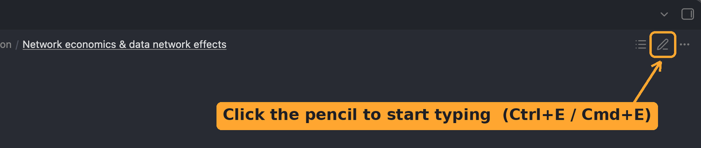

You only need a handful of things to use Obsidian well. This page covers all of them.

## A vault is just a folder

Your "vault" is the folder you opened. Every note inside it is a normal file ending in `.md` (a plain text file). Obsidian is a nice way of reading, writing and linking those files.

## The screen

- **Left sidebar:** your files and folders. The notes pinned at the top are the ones you'll use most.
- **Middle:** the note you're reading.
- **Right sidebar:** extras like the outline of the current note and the calendar. You can open and close both sidebars with the buttons at the top corners.

## Reading view and Editing view

This is the one thing that confuses everyone at first. Every note has two views:

| Reading view | Editing view |
| --- | --- |
| How notes open in this vault | Where you type |
| Tables, boards and boxes look finished | You see the raw text behind them |
| You can't type here | You can type anywhere |
| 📖 book icon at the top-right of the note | ✏️ pencil icon at the top-right of the note |

To switch between them, press `Ctrl+E` (Windows) or `Cmd+E` (Mac), or click the icon at the top-right of the note:



In Editing view the pencil changes to a 📖 book. Click it to go back to Reading view.

> **If you click into a note and nothing happens when you type, you're in Reading view.** Press `Ctrl+E` / `Cmd+E`.

## Writing: what you type and what you see

You format notes with a few symbols. This is called **Markdown**, and it's worth learning: it's the same formatting used on GitHub, in Notion and Slack, and by AI tools like ChatGPT and Claude. You don't need to memorise these, because the toolbar at the top of the note (from the Editing Toolbar plugin) can do most of them with a click.

| What you type | What you see |
| --- | --- |
| `# Title` | A big heading |
| `## Section` | A medium heading |
| `### Small heading` | A small heading |
| `**important**` | **important** (bold) |
| `*note*` | *note* (italic) |
| `- an item` | A bullet point |
| `1. first step` | A numbered list |
| `- [ ] something to do` | A tickable checkbox (see [11 To-dos](11%20To-dos.md)) |
| `[[Another note]]` | A link to another note (see [07 Linking notes and the graph view](07%20Linking%20notes%20and%20the%20graph%20view.md)) |
| `> a quote` | An indented quote bar, great for key points |

## Properties

The grey box at the very top of a note is its **properties**: facts about the note, like which module it's for, the week, and how well you understand it.

The dashboards read these properties, which is how your notes sort themselves. Usually you fill them in straight from a dashboard table, without opening the note. [08 Taking notes](08%20Taking%20notes.md) explains each one.

## Callouts: the coloured boxes

The coloured boxes you see around the vault are called **callouts**. To make one, in Editing view, type:

```
> [!tip] Your title here
> The text inside the box.
```

You can use `tip`, `note`, `summary`, `warning`, `question` or `example` in the brackets, and each gives a different colour. Put a `-` after the brackets, like `> [!tip]-`, to make the box fold shut until it's clicked.

## Shortcuts worth knowing

On Mac, use `Cmd` wherever it says `Ctrl`.

| Shortcut | What it does |
| --- | --- |
| `Ctrl+E` | Switch between Reading and Editing view |
| `Ctrl+O` | Open any note by typing part of its name |
| `Ctrl+P` | The command palette: type what you want to do, e.g. "new note" |
| `Ctrl+Shift+F` | Search inside every note |
| `Ctrl+G` | Open the graph view |
| `Ctrl+N` | New note |
| `Ctrl+Z` | Undo |
| `Ctrl` + click a link | Open it in a new tab |

> **If you only remember one shortcut, make it `Ctrl+P` / `Cmd+P`.** Type a few words of what you want and Obsidian finds the action for you.

To go back to the note you were on before, click the ← arrow at the top-left of the note.

---

⬅️ Previous: [02 Install and set up](02%20Install%20and%20set%20up.md) · [📘 Contents](00%20Start%20here.md) · Next: [04 Working with files](04%20Working%20with%20files.md) ➡️
