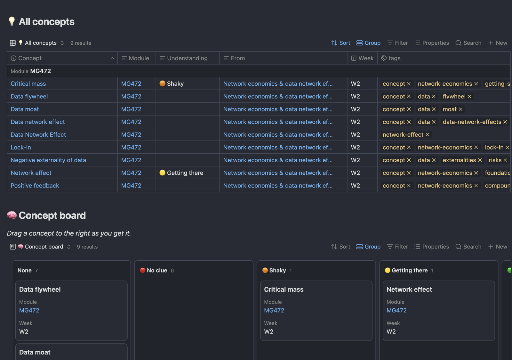
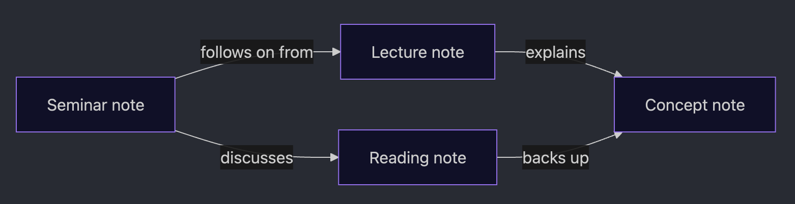

Each folder has one job. Here's what goes where, and why.

| Folder | What goes in it | Example |
| --- | --- | --- |
| `01 UNI/01 Modules` | One folder per module: its dashboard, your class notes, its deadlines and slides | `MG472 W03 Lecture - Network economics` |
| `01 UNI/02 Concepts` | One big idea per note, in your own words | `Network effect` |
| `01 UNI/03 Literature` | Papers, readings and cases, and what you took from them | `Parker et al (2016) Platform Revolution` |
| `Books` | Books you're reading, for fun or career prep | `Thinking, Fast and Slow` |
| `Job Hunt` | One note per job application | `Example Company - Graduate Analyst` |
| `Daily Notes` | Optional diary-style notes, made from the calendar | `20-10-2026` |
| `00 Meta` | The vault's machinery: pasted images and the `.base` files | You don't need to open it |
| `Manual` | This manual | |

## Modules: what happened in class

Each module folder holds your notes from its lectures, seminars, workshops and guest talks, in the order they happened. Its **dashboard** (the note named after the module code, e.g. `MG472`) shows all of them, plus that module's readings, concepts and deadlines.

## Concepts: what you actually learnt

A concept note is **one idea, explained by you**. For example, after a lecture on network effects you might write concept notes on *network effect*, *critical mass* and *lock-in*.

> **Why bother?** Rereading slides feels like studying, but it doesn't stick. Explaining an idea in your own words, then testing yourself on it later, does. Concept notes give you both.

**Make them work like flashcards.** Write the heading as a question, and put the answer in a quote bar underneath:

```
## What is a network effect?

> A product becomes more valuable to each user as more people use it.
```

Before an exam, read only the questions and try to answer them before looking. The 🟢 / 🟡 / 🟠 / 🔴 rating on each concept tells you which ones to test yourself on first (see [09 Ratings and boards](09%20Ratings%20and%20boards.md)).

The 💡 Concepts Dashboard lists every concept with its module, rating, the class it came from and the week, plus a board you can drag concepts across:



*From my own vault, so the note names are different from yours. I hadn't rated all my concepts yet when I took this (I was still testing), which is why some Understanding cells are empty. You'll want to rate all of yours.*

Concepts aren't inside a module folder because big ideas come up in more than one module, and again in essays and your dissertation. Each concept still has a `course` property, so it appears on its module's dashboard anyway.

## Literature: what you read

A literature note is for a **paper, reading or case**: what the argument was, the key ideas, what you think, and quotes worth keeping (with page numbers, for essays). Save the PDF in `03 Literature/PDFs` and link it from the note.

Like concepts, readings live in one shared folder because they come back again and again, especially in essays and your dissertation.

## How they connect

The real power comes from linking them together:



For example: your **lecture** note links to the **concept** "network effect". Your **reading** note on Shapiro & Varian links to the same concept. Your **seminar** note links to both the lecture and the reading. Months later, opening the concept shows you every lecture, reading and seminar where it came up.

You make these connections with links. [07 Linking notes and the graph view](07%20Linking%20notes%20and%20the%20graph%20view.md) shows you how.

## Books and Job Hunt

These two have nothing to do with modules, but they're handy to keep in the same place.

- **Books:** add a book with **+ New** on the 📚 Books Dashboard, set its status (To read, Reading, Finished), and drag it across the reading board as you go.
- **Job Hunt:** a tracker for your job applications. Add each one with **+ New** in **🔥 To apply** on the 💼 Job Hunt Dashboard, and fill in the company, deadline and link. Then:
  - each application counts down to its deadline (🔴 within 3 days, 🟠 this week, 🟡 within 2 weeks, 🟢 later), and anything closing in the next 2 weeks also shows on the Main Dashboard
  - as you move through the stages (applied, online test, interview…), drag its card across the board
  - when you apply, fill in `applied_date`. If 3 weeks pass with no `next_step`, it gets a 📞 reminder to chase it
  - the `sponsorship` column records whether the employer sponsors visas
  - when an application ends, write why in `outcome_reason`, so you can spot patterns later

Each dashboard has a folded **➕ How to add** box with the details.

---

⬅️ Previous: [05 Your first 10 minutes](05%20Your%20first%2010%20minutes.md) · [📘 Contents](00%20Start%20here.md) · Next: [07 Linking notes and the graph view](07%20Linking%20notes%20and%20the%20graph%20view.md) ➡️
