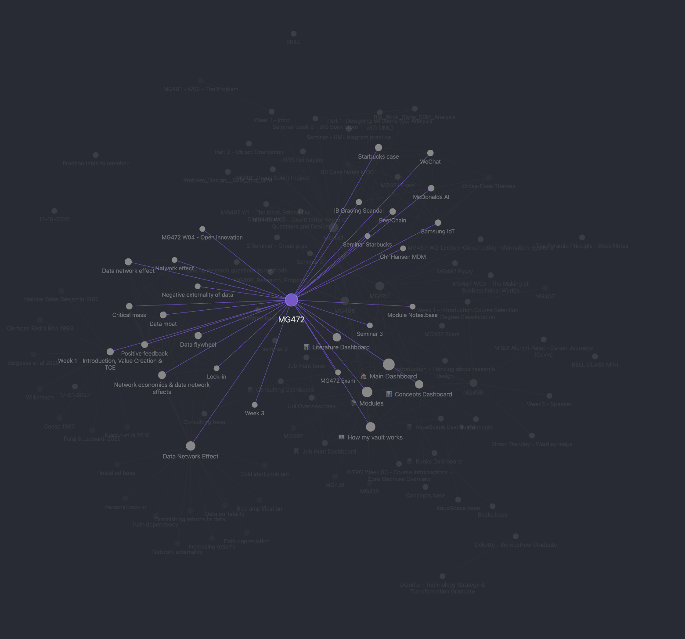
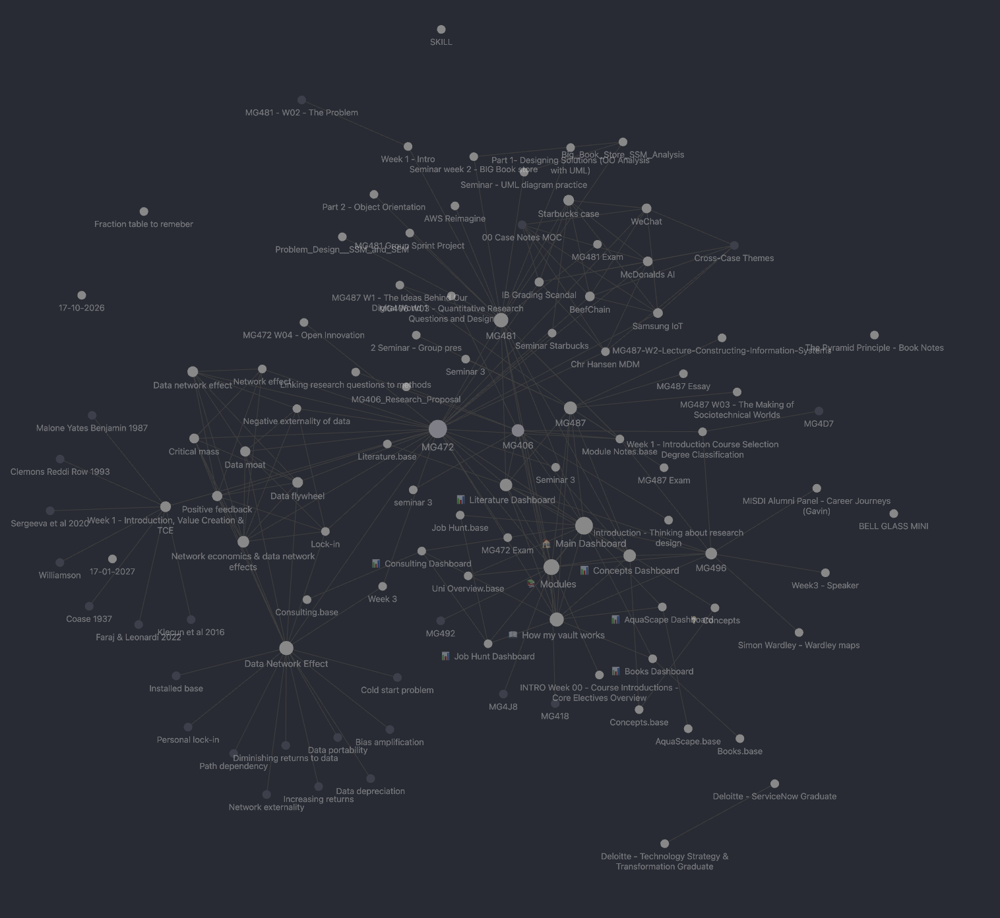

Linking is what makes Obsidian different from Word. Every note can point to any other note, so your notes become a web of connected ideas instead of a pile of separate files.

## Making a link

1. In Editing view, type two square brackets: `[[`
2. Start typing the name of the note you want. A list of matching notes appears.
3. Click the right one, or press Enter.

| What you type | What you see |
| --- | --- |
| `[[Network effect]]` | A clickable link called "Network effect" |
| `[[Network effect#Why does it matter?]]` | A link straight to one heading inside the note |

To make a link show different words, add a straight line `|` and your words after the name:

> `[[Network effect|this idea]]` shows "this idea", but clicking it opens "Network effect".

A link to a note that doesn't exist yet looks faded. Clicking it creates that note, which is a quick way to start a new concept note while you're writing.

## Where links are useful

- In a **lecture** note, link each big idea to its **concept** note.
- In a **seminar** note, link the **reading** and the **lecture** it's about.
- In a **concept** note, link the reading that explains it best.
- In an **essay plan**, link every reading you want to use.

## Backlinks: who links to this note?

Every link works in both directions. Open any note, and Obsidian can show you every other note that links *to* it. These are called **backlinks**.

To see them, open the right sidebar (top-right corner button) and choose **Backlinks**, or press `Ctrl+P` / `Cmd+P` and type "backlinks".

> **This is the magic part.** Open the concept "network effect" in May, and its backlinks show every lecture, seminar and reading where it came up.

## The graph view

The graph view draws your whole vault as a map. Each dot is a note, and each line is a link.

- Open it with `Ctrl+G` / `Cmd+G`, or the graph icon in the left-hand bar.
- **Hover over a dot** to highlight everything linked to it.
- **Click a dot** to open that note.
- Scroll to zoom, and drag to move around.

Here's my own vault a few weeks into term (these are just my personal notes so far). Hovering over one module lights up every lecture, concept, case and reading connected to it:

And the whole vault at once:

Your graph starts small and grows as you write and link notes. The example notes already link to each other, so you'll see a small cluster straight away.

## Tidying the graph

The graph also shows dashboards and settings files, which can get busy. To see only your uni notes:

1. In the graph view, click the ⚙️ at its top-right.
2. Under **Filters**, in the search box, type `path:"01 UNI"`.

To see the links around just one note, open the note, press `Ctrl+P` / `Cmd+P` and type "local graph".

---

⬅️ Previous: [06 How the folders work together](06%20How%20the%20folders%20work%20together.md) · [📘 Contents](00%20Start%20here.md) · Next: [08 Taking notes](08%20Taking%20notes.md) ➡️
