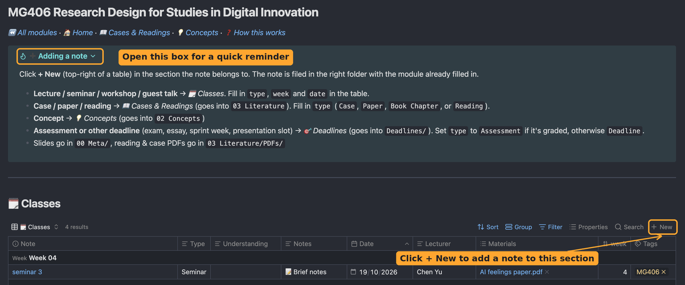
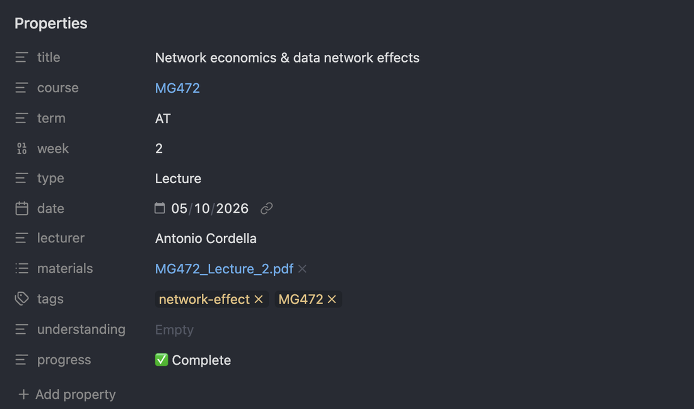

## Adding a note

> **Always start from a module dashboard and click + New.** The note is put in the right folder and linked to the module automatically.

Every module dashboard has a folded **➕ Adding a note** box at the top with a short version of this page, so you don't need to come back here each time.

Open the module's dashboard (from the 🏠 Main Dashboard) and click **+ New** at the top-right of the right section:

| You want to add… | Click + New in… | Where the note is saved |
| --- | --- | --- |
| A lecture, seminar, workshop or guest talk | 🗓️ **Classes** | The module's folder |
| A case, paper or reading | 📖 **Cases & Readings** | `01 UNI/03 Literature` |
| A concept | 💡 **Concepts** | `01 UNI/02 Concepts` |
| An exam, essay or other deadline | 🎯 **Deadlines** | The module's `Deadlines` folder (see [10 Deadlines](10%20Deadlines.md)) |

Then:

1. **Name the note.** Open it and click its title at the top. A clear pattern helps, e.g. `MG472 W03 Lecture - Network economics`.
2. **Fill in its details** in the dashboard table. Click an empty cell and type.

## Naming your notes

A consistent pattern makes notes easy to find with `Ctrl+O` / `Cmd+O`:

| Kind of note | Suggested name |
| --- | --- |
| Lecture | `MG472 W03 Lecture - Network economics` |
| Seminar | `MG472 W03 Seminar - Platform case` |
| Reading | `Author (year) Short title`, e.g. `Afuah (2013) Are network effects all about size` |
| Case | `Case - Starbucks digital transformation` |
| Concept | Just the idea, e.g. `Network effect` |

## The properties, explained

Properties are the details in the box at the top of each note. The dashboards use them to sort everything. Here's what they look like on a finished lecture note:

| Property | What it means | Example |
| --- | --- | --- |
| `course` | Which module it belongs to. **+ New fills this in for you** | `[[MG472]]` |
| `type` | What kind of note it is | `Lecture` |
| `week` | Which teaching week (a number) | `3` |
| `date` | The date of the class | `2026-10-15` |
| `lecturer` | Who taught it | Any name |
| `materials` | Links to the slides or PDFs | `[[Week 3 slides.pdf]]` |
| `understanding` | How well you get it (see [09 Ratings and boards](09%20Ratings%20and%20boards.md)) | `🟡 Getting there` |
| `progress` | How finished the note is | `📝 Brief notes` |

To fill in a date, click the cell and pick from the calendar.

## Typing values: copy them exactly

Some properties only accept certain values, and the spelling must match exactly, including capitals and emoji. `lecture` is not the same as `Lecture`, and the dashboards won't find it.

| Property | Allowed values |
| --- | --- |
| `type` (classes) | `Lecture` · `Seminar` · `Workshop` · `Guest Talk` |
| `type` (readings) | `Case` · `Paper` · `Book Chapter` · `Reading` |
| `understanding` | `🔴 No clue` · `🟠 Shaky` · `🟡 Getting there` · `🟢 Solid` |
| `progress` | `📝 Brief notes` · `✍️ Writing up` · `✅ Complete` |

> [!TIP]
> You rarely need to type these. Dragging a card on a board writes the value for you, and when you start typing in a property, Obsidian suggests values you've used before. Pick the suggestion instead of finishing the word. Every dashboard also has a folded **📋 Values to copy-paste** box.

## The one rule

> **A note only shows on a module's dashboard if its `course` property links to that module**, e.g. `[[MG472]]`.

**+ New** does this for you. If you make a note some other way, add the property yourself: open the note, press `Ctrl+;` / `Cmd+;` (add property), type `course`, then type `[[MG472]]` as the value.

## What to write

That's up to you. If you want a starting point, the example lecture note uses this shape:

1. A one-line summary of the whole lecture at the top.
2. Headings written as questions, e.g. "What is a network effect?".
3. A short answer in a `>` quote bar under each heading.
4. A few self-test questions at the end.
5. A `### TODO` heading for anything to follow up (see [11 To-dos](11%20To-dos.md)).

---

⬅️ Previous: [07 Linking notes and the graph view](07%20Linking%20notes%20and%20the%20graph%20view.md) · [📘 Contents](00%20Start%20here.md) · Next: [09 Ratings and boards](09%20Ratings%20and%20boards.md) ➡️
