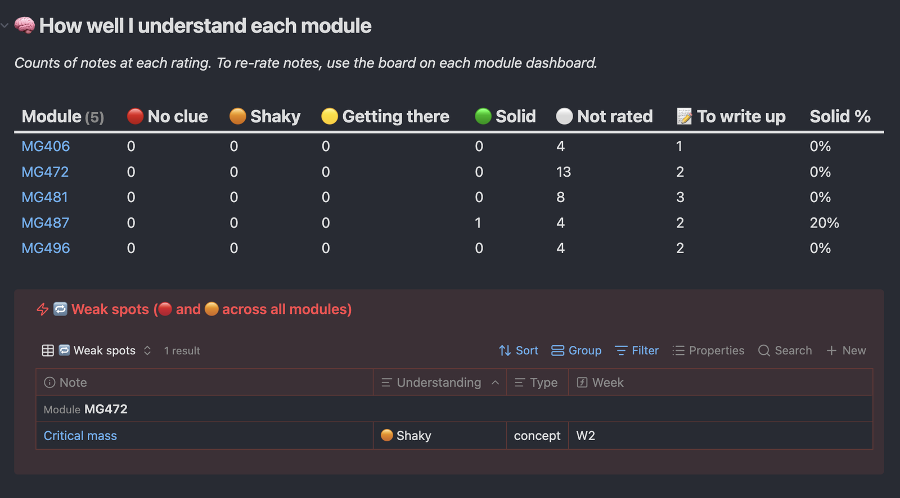
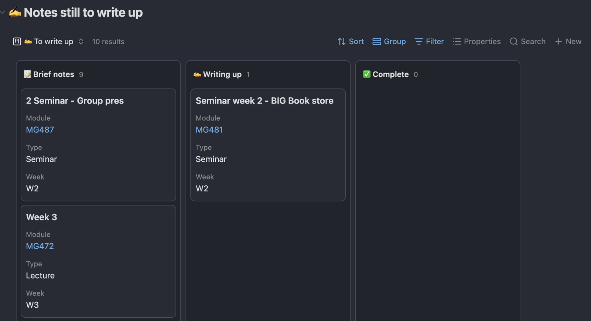

## Rating how well you understand something

Every lecture, seminar, reading and concept note has an `understanding` rating. Rate it after class, and change it as you revise.

| Rating | What it means | What to do |
| --- | --- | --- |
| *(blank)* | Not rated yet | Rate it after class |
| 🔴 **No clue** | I couldn't explain it | Rewatch or reread it, ask in the seminar |
| 🟠 **Shaky** | I get the gist but would struggle in an exam | Revise it this week |
| 🟡 **Getting there** | I could explain most of it | Quick review before exams |
| 🟢 **Solid** | I could teach it to someone | Leave it |

> **Why four levels, not three?** With three, almost everything ends up in the middle. Splitting the middle into 🟠 and 🟡 tells you what to revise *first*.

**Where your ratings show up:**

- Each module dashboard has **🔁 Revise next**: the 8 classes you understand least.
- The **📚 Modules** page counts how many notes are at each rating, for every module.
- The **🏠 Main Dashboard** and **📚 Modules** page list your **🔁 Weak spots** (everything 🔴 or 🟠).

*From my own vault, so the note names are different from yours.*

## How finished a note is

`progress` is separate from understanding. It tracks how finished the *note itself* is:

> `📝 Brief notes` (jotted in class) → `✍️ Writing up` → `✅ Complete`

The **📚 Modules** page lists every note that isn't complete yet, so nothing stays half-written:

*From my own vault, so the note names are different from yours.*

## The boards

A board shows your notes as cards in columns, like sticky notes on a wall. **Each card is a note.**

| To… | Do this |
| --- | --- |
| Change a note's rating | Drag its card to another column |
| Open the note | Click the card |
| Make a new note already in a column | Click the **+** at the top of that column |

| Board | Where to find it | Columns are… |
| --- | --- | --- |
| 🧠 Understanding board | Each module dashboard | understanding |
| ✍️ Notes board | Each module dashboard (folded at the bottom) | progress |
| 🧠 Understanding board | 📖 Literature Dashboard | understanding |
| 🧠 Concept board | 💡 Concepts Dashboard | understanding |
| 🗂️ Board | 💼 Job Hunt Dashboard | application stage |
| 🗂️ Reading board | 📚 Books Dashboard | reading status |

---

⬅️ Previous: [08 Taking notes](08%20Taking%20notes.md) · [📘 Contents](00%20Start%20here.md) · Next: [10 Deadlines](10%20Deadlines.md) ➡️
