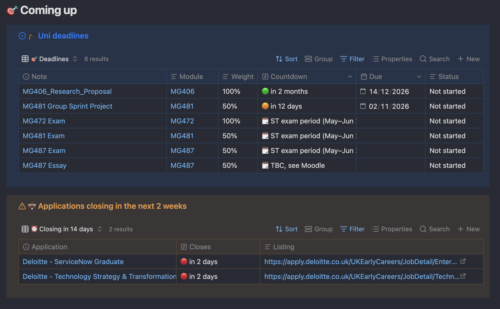

Every exam, essay and project is a note in its module's `Deadlines` folder. The dashboards turn those notes into a countdown, so you can see what's coming up.

> **Good news:** the deadlines for the compulsory modules (MG406, MG472, MG481, MG487) are already there. You only need to add a date once Moodle confirms it.

## Adding a deadline

1. On the **🏠 Main Dashboard**, open the module (e.g. **MG481 · Org IT**).
2. Scroll down to **🎯 Deadlines**.
3. Click **+ New** at the top-right of that table.
4. Open the new note, click its title at the top (it says "Untitled"), and name it, e.g. `MG481 Essay`. Come back with the ← arrow.
5. In the table, fill in:
   - `type`: `Assessment` if it's marked, or `Deadline` if it isn't (see below)
   - `weight`: how much it counts, e.g. `50%`
   - `due`: click the cell and pick the date from the calendar
   - `status`: `Not started`

It now appears on the module dashboard, on the 📚 Modules page, and in **🎯 Coming up** on the Main Dashboard:

*From my own vault, so the note names are different from yours.*

## Assessment or Deadline?

| Assessment | Deadline |
| --- | --- |
| Marked work that counts towards your grade | Anything else with a date |
| Exams, essays, projects, presentations | A group meeting, a sprint week, a presentation slot, a form to submit |
| Status: `Not started` → `In progress` → `Submitted` → `Graded` | Status: `Not started` → `Done` |
| Has a `weight` and a `grade` | No weight or grade |

## When you don't know the date yet

Leave `due` empty and write what you know in `due_note`, e.g. `ST exam period` or `TBC, see Moodle`. It shows as ❔ TBC until you add the real date.

## Reading the countdown

| You see | It means |
| --- | --- |
| 🔴 in 3 days | Due within the next week |
| 🟠 in 2 weeks | Due within 3 weeks |
| 🟢 in 2 months | Due later |
| ⚫ Passed | The date has gone and it isn't marked done |
| ✅ Submitted | You've set the status to Submitted, Graded or Done |
| ❔ TBC | No date yet |

## Keeping it up to date

- When you hand something in, change its `status` to `Submitted`. It stops counting down.
- When you get the mark back, change `status` to `Graded` and fill in `grade`.
- Use the note itself for anything else: the question, your plan, and sources. The deadline notes come with those headings ready.

---

⬅️ Previous: [09 Ratings and boards](09%20Ratings%20and%20boards.md) · [📘 Contents](00%20Start%20here.md) · Next: [11 To-dos](11%20To-dos.md) ➡️
