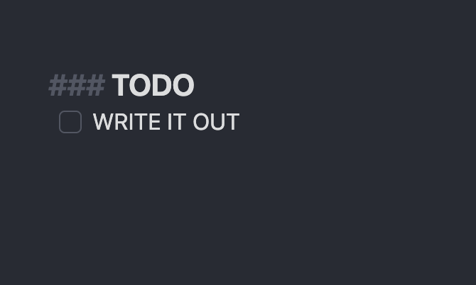
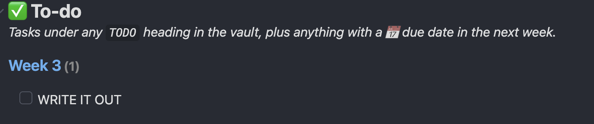

## What's a to-do?

A to-do is a line in a note with a little box in front of it, which you tick when it's done. It's a checklist, written inside your notes, so the task sits right next to what it's about.

The **🏠 Main Dashboard** collects to-dos from across your whole vault into one list, so you never have to go looking for them.

## Making a to-do

There are two ways to make one, in Editing view (`Ctrl+E` / `Cmd+E`):

- **Easiest:** type the task, e.g. `Email the seminar leader`, then press `Ctrl+L` / `Cmd+L`. It turns into a checkbox.
- **Or type it out:** a dash, a space, square brackets with a space inside, another space, then the task.

| What you type | What you see |
| --- | --- |
| `- [ ] Email the seminar leader` | ☐ Email the seminar leader |
| `- [x] Email the seminar leader` | ☑ ~~Email the seminar leader~~ |

To tick it off, just click the box (this works in Reading view too).

## Getting to-dos onto the Main Dashboard

The Main Dashboard only shows to-dos that are written **under a heading called TODO**. A heading is a title line, and three `#` symbols make a small heading. So, in any note, type this on its own line:

```
### TODO
```

Then put your to-dos on the lines underneath:

| What you type | What you see |
| --- | --- |
| `### TODO` | **TODO** as a small heading |
| `- [ ] Finish the reading` | ☐ Finish the reading |
| `- [ ] Ask about the essay word count` | ☐ Ask about the essay word count |

> **Write it exactly like that:** three `#` symbols, a space, then `TODO`. Anything listed under it appears in **✅ To-do** on the Main Dashboard, grouped by the note it came from.

| In your note (Editing view) | On the Main Dashboard |
| --- | --- |
|  |  |

Here the to-do is in a note called "Week 3", so on the dashboard it appears under **Week 3**.

Why under a heading? So that you choose what reaches the dashboard. A checklist in the middle of your notes (e.g. "points to cover in my essay") stays in the note, and only the things under **TODO** become real to-dos.

When you tick a to-do, it disappears from the dashboard. You'll also see a ✅ and today's date appear after it in the note. That's normal: it records when you finished it.

## Adding a due date

A to-do with a due date also shows on the Main Dashboard in the week before it's due, even if it isn't under a TODO heading. The easy way to add one:

1. Click on the to-do's line in Editing view.
2. Press `Ctrl+P` / `Cmd+P` and type "Tasks: Create or edit task".
3. In the box that opens, type the date in **Due** (you can even type words like `friday` or `next monday`) and click **Apply**.

It then looks like this in the note:

> `- [ ] Submit the reading reflection 📅 2026-10-30`

## Other places to-dos show up

- Each **module dashboard** has **✅ To-dos in this module**, showing every unticked box in that module's folder, with or without a TODO heading.
- The **💼 Job Hunt Dashboard** lists to-dos from your job application notes.

---

⬅️ Previous: [10 Deadlines](10%20Deadlines.md) · [📘 Contents](00%20Start%20here.md) · Next: [12 Adding a new module](12%20Adding%20a%20new%20module.md) ➡️
