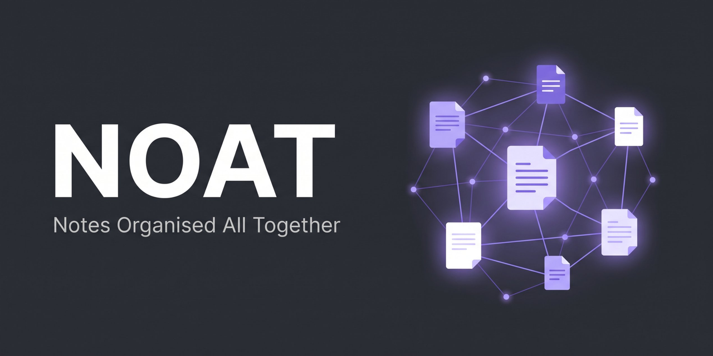

   

**NOAT is a note system for LSE MISDI students.** It keeps your lecture notes, readings, PDFs, ideas and deadlines in one place, and sorts them for you. It's a ready-made [Obsidian](https://obsidian.md) vault made for MISDI, but [any student can use it](#not-on-misdi). **No tech experience needed.**

Made by Bipindra Rai, MISDI 2026–27 · [Why I made it](#about)

**[Get started](#get-started)** · **[What's inside](#whats-inside)** · **[Job hunting](#job-hunting-too)** · **[The manual](#the-manual)** · **[Updating](#updating-and-what-not-to-edit)** · **[Feedback](#feedback-and-ideas)**


*NOAT's Main Dashboard, exactly as it looks when you first open it.*

---

## Why NOAT?

| Without NOAT | With NOAT |
| --- | --- |
| Notes spread across Word, slides, the Notes app and Moodle | Every module has one folder and one dashboard |
| Guessing what to revise before exams | Every note has a rating (🔴 → 🟢), and your weakest topics are listed first |
| Deadlines on five different Moodle pages | One colour-coded countdown for every deadline |
| Ideas stuck inside one module | Concepts and readings link across all your modules |
| Job applications in a spreadsheet you forget to update | An application tracker with deadline countdowns, right next to your uni deadlines |

---

## Get started

Takes about 5 minutes. **You don't need a GitHub account.**

### 1. Install Obsidian

Download it free from [obsidian.md/download](https://obsidian.md/download) and install it like any app.

### 2. Get NOAT onto your computer

There are two ways. Both give you exactly the same vault, so pick whichever suits you:

| | Option A: Download the ZIP | Option B: Clone with git |
| --- | --- | --- |
| **Best for** | No tech fuss, just clicking | Learning a bit of git along the way 😉 |
| **You need** | Nothing extra | Git (free) and a few typed commands |
| **Getting updates later** | Download again and copy NOAT's files over | Type one command: `git pull` |

#### Option A: Download the ZIP (easiest)

1. At the top of this page, above the list of files, click the green **<> Code** button, then **Download ZIP** at the bottom of the menu. A file called `NOAT-main.zip` lands in your Downloads.
2. Unzip it. A ZIP is a compressed folder:

| Mac | Windows |
| --- | --- |
| Double-click `NOAT-main.zip` | Right-click `NOAT-main.zip` → **Extract All…** → **Extract** |

3. Move the folder somewhere permanent, like Documents, iCloud Drive or Google Drive, not Downloads. Rename it if you like, e.g. `MISDI Notes`.

> [!TIP]
> - Download with **Download ZIP**, not file by file. The ZIP includes hidden settings the dashboards need.
> - On Windows, if `NOAT-main` contains another `NOAT-main` folder, use the inner one: the one with `🏠 Main Dashboard.md` inside.

#### Option B: Clone with git (learn a bit of git 😉)

Git is the tool developers use to download projects and keep them up to date. It's a handy skill for MISDI and beyond, and you only need three commands.

1. **Install git.**
   - **Mac:** open the **Terminal** app and type `git --version`, then press Enter. If git isn't installed, your Mac offers to install it. Click **Install**.
   - **Windows:** download **Git for Windows** from [git-scm.com](https://git-scm.com/downloads) and install it with the default settings. Then open **PowerShell**.
2. **Go to your Documents folder.** In Terminal (Mac) or PowerShell (Windows), type:

   ```
   cd ~/Documents
   ```

3. **Download NOAT.** Copy and paste this, then press Enter. The part in quotes is the folder name, so change it if you like:

   ```
   git clone https://github.com/BipinJungRai/NOAT.git "MISDI Notes"
   ```

   A folder called `MISDI Notes` appears in your Documents.

> [!WARNING]
> If you use git, keep the folder on your computer (e.g. Documents), not in iCloud Drive or Google Drive. Sync apps can damage git's hidden files.

To get updates later, open Terminal or PowerShell and type `cd ~/Documents/"MISDI Notes"`, then `git pull`. That's it. More in [Updating and what not to edit](Manual/15%20Updating%20and%20what%20not%20to%20edit.md).

### 3. Open it in Obsidian

On the Obsidian start screen, click **Open** next to **Open folder as vault**, and select your NOAT folder:


### 4. Click "Trust author and enable plugins"

This switches on the add-ons that make the dashboards work.

The Main Dashboard opens. Now read [the manual](Manual/00%20Start%20here.md), starting at page 01 (about 15 minutes).

> [!TIP]
> Want your notes on your iPhone later? Use Option A and keep the folder in **iCloud Drive**. More options: [Install and set up](Manual/02%20Install%20and%20set%20up.md).

---

## What's inside

| Feature | What it does for you |
| --- | --- |
| 🏠 **Main Dashboard** | Today's term week, upcoming deadlines, your to-dos and your weakest topics, on one page |
| 📚 **Module dashboards** | MG406, MG472, MG481, MG487 and MG496 are ready to use. Add assessment deadlines and other important dates yourself as they come up throughout term |
| 🧠 **Understanding ratings** | Rate each class 🔴 No clue → 🟢 Solid, drag cards on a board, and get a "revise next" list |
| 🎯 **Deadline countdowns** | Every exam, essay and project, colour-coded by how soon it's due |
| 💡 **Concept notes** | One idea per note, in your own words. They work like flashcards you can always come back to |
| 📖 **Readings and cases** | Notes on papers and cases, linked to the modules and seminars they belong to |
| 💼 **Job tracker** | Applications, deadlines and stages, on a drag-and-drop board |
| 📚 **Book tracker** | What you're reading, and what you thought of it |
| 👀 **Example notes** | One of each kind of note, to show how everything works. Delete them when you're ready |

<details>
<summary><b>See more screenshots</b></summary>

<br>

**Concepts:** each concept with its module, rating, the class it came from and the week.


*I hadn't rated all my concepts yet when I took this (I was still testing), which is why some Understanding cells are empty. You'll want to rate all of yours.*

**Understanding:** how well you understand each module, and your weak spots.


*Screenshots from my own vault, so the note names are different from yours.*

</details>

---

## Job hunting too

I know a lot of us are applying for jobs alongside our studies, so NOAT has an application tracker built in. It keeps your job search organised in the same place as your uni work:

| Feature | What it does for you |
| --- | --- |
| 📝 **One note per application** | Company, role, programme, location, deadline and the link to the listing, plus space for the job description, why you're a fit, and interview prep |
| ⏰ **Deadline countdown** | Every open application shows how long is left: 🔴 within 3 days, 🟠 this week, 🟡 within 2 weeks, 🟢 later |
| 🏠 **On your Main Dashboard** | Applications closing in the next 2 weeks appear next to your uni deadlines, so nothing slips |
| 🗂️ **Drag-and-drop board** | Move each application through the stages: Not applied → Applied → Online test → Interview → Assessment centre → Offer |
| 📞 **Chase reminders** | Anything you applied to over 3 weeks ago with no next step gets flagged, so you know to check the portal or follow up |
| 🛂 **Visa column** | Note whether each employer sponsors visas, so you can filter at a glance |
| 🗄️ **Outcomes log** | Record why an application ended (e.g. "failed the numerical test") and spot patterns over time |


*From my own Main Dashboard: uni deadlines on top, applications closing soon underneath.*

To add an application, open the **💼 Job Hunt Dashboard** and click **+ New** in **🔥 To apply**. More in [How the folders work together](Manual/06%20How%20the%20folders%20work%20together.md).

---

## Not on MISDI?

You can still use NOAT. It works for any course.

I made it for our MISDI class, so it comes with the compulsory MISDI Autumn Term modules (MG406, MG472, MG481, MG487 and MG496) already set up. To make it yours, just rename the module folders and dashboards to your own modules, and delete the ones you don't need. Obsidian updates every link to a renamed note automatically, so your notes, tables and boards keep working.

Step by step, including the couple of pages you'll need to edit by hand: [Using NOAT for a different course](Manual/12%20Adding%20a%20new%20module.md).

---

## Your notes link together

In Obsidian, any note can link to any other: type `[[`, pick a note, and they're connected. Link a lecture to the ideas it covered, the reading behind them and the seminar where you discussed them, and months later one click shows everything connected to an idea.

The graph view draws those links as a map. Here's my own vault a few weeks into term. Hovering over one module lights up everything linked to it:


Your graph starts small and grows as you link your notes. [How linking works](Manual/07%20Linking%20notes%20and%20the%20graph%20view.md).

---

## The manual

The manual explains everything in plain words. It's here on GitHub, and inside the vault in the `Manual` folder.

**New to Obsidian? Read these first (about 15 minutes):**

| Page | What you'll learn |
| --- | --- |
| [01 Why use this system](Manual/01%20Why%20use%20this%20system.md) | What NOAT does for you |
| [02 Install and set up](Manual/02%20Install%20and%20set%20up.md) | Getting it onto your computer, and where to keep it |
| [03 Obsidian basics](Manual/03%20Obsidian%20basics.md) | Reading vs Editing view, formatting, shortcuts |
| [04 Working with files](Manual/04%20Working%20with%20files.md) | Making, renaming, moving and deleting notes; adding slides and PDFs |
| [05 Your first 10 minutes](Manual/05%20Your%20first%2010%20minutes.md) | A guided tour using the example notes |

**Use these when you need them:**

| Page | What you'll learn |
| --- | --- |
| [06 How the folders work together](Manual/06%20How%20the%20folders%20work%20together.md) | What each folder is for, and why concept notes help you learn |
| [07 Linking notes and the graph view](Manual/07%20Linking%20notes%20and%20the%20graph%20view.md) | Connecting notes, and seeing them as a map |
| [08 Taking notes](Manual/08%20Taking%20notes.md) | Adding lecture, seminar, reading and concept notes |
| [09 Ratings and boards](Manual/09%20Ratings%20and%20boards.md) | Rating your understanding, and the drag-and-drop boards |
| [10 Deadlines](Manual/10%20Deadlines.md) | Adding exams, essays and other deadlines |
| [11 To-dos](Manual/11%20To-dos.md) | To-do lists that show up on your dashboard |
| [12 Adding a new module](Manual/12%20Adding%20a%20new%20module.md) | Setting up your Winter Term electives, or using NOAT for a different course |
| [13 What is a base file](Manual/13%20What%20is%20a%20base%20file.md) | How the tables and boards work |
| [14 Plugins included](Manual/14%20Plugins%20included.md) | The add-ons that come with NOAT |
| [15 Updating and what not to edit](Manual/15%20Updating%20and%20what%20not%20to%20edit.md) | Getting new versions without losing notes |
| [16 Troubleshooting](Manual/16%20Troubleshooting.md) | Fixes for common problems |

---

## Optional: Word and PowerPoint files

Some lecturers upload `.docx` and `.pptx` files. NOAT can show them inside Obsidian once you install the free **LibreOffice**:

| Your computer | How to install |
| --- | --- |
| Any | Download it from [libreoffice.org](https://www.libreoffice.org/download/download-libreoffice/) and install it normally |
| Mac (with [Homebrew](https://brew.sh)) | In Terminal: `brew install --cask libreoffice` |
| Windows | In PowerShell: `winget install -e --id TheDocumentFoundation.LibreOffice` |

Then quit Obsidian completely and reopen it. NOAT finds LibreOffice by itself. [More detail](Manual/02%20Install%20and%20set%20up.md).

---

## Updating and what not to edit

New versions bring fixes and features. Every file belongs to one side, so updating never touches your notes:

| 🔒 NOAT's files: please don't edit | ✏️ Your files: edit freely |
| --- | --- |
| `.obsidian` (settings and plugins), `00 Meta/Bases`, `Manual` | Every note you write, and your screenshots in `00 Meta/Attachments` |
| The dashboards that came with NOAT (any page with a 🔒 Template file box at the bottom) | `My electives`, the deadline notes, and any module you add yourself |

To update, download the new ZIP (same steps as [Get started](#get-started)) and copy NOAT's files over the old ones. If you used git, just run `git pull` inside your NOAT folder. Step by step: [Updating and what not to edit](Manual/15%20Updating%20and%20what%20not%20to%20edit.md). New versions and what changed are listed under **Releases** on this page.

---

## Feedback and ideas

Something not working, or an idea for something you'd like added or changed? **Please tell me.**

- Message me on WhatsApp (I'm in the MISDI group chat), or
- open an **Issue** at the top of this page (needs a free GitHub account).

This is an early version and will change over time based on what people find useful.

> [!NOTE]
> **On Windows? Please tell me how setup went.** I built and tested NOAT on a Mac, so feedback from Windows users really helps. One thing I'd like checked: Windows can't handle file paths longer than 260 characters, and the MG496 folder has a very long name. It should be fine, but if any files are missing after you unzip, or you see a "path too long" error, let me know. The fix is renaming the folder to something shorter, like `MG496 Study Skills`, which is safe because every link to it updates automatically.

---

## About

Hi, I'm **Bipindra Rai**, an MISDI 2026–27 student at LSE.

I made NOAT because I kept hearing people say they wanted a better way to store and organise their thoughts, along with all the PDFs from lectures and readings: somewhere everything lives together, where you can sort through it, connect ideas and actually think. After researching the options online, I came across Obsidian and built NOAT on top of it.

I'm new to Obsidian too, so this is a work in progress. I wanted to share it with the class because I think it can help all of us, whether that's swapping ideas and building on each other's thinking, or just solving someone's own note-taking problems.

*NOAT is an unofficial student project, not an LSE tool. Always check Moodle for official dates and assessment details.*

---

## Licence

NOAT is released under the [MIT licence](LICENSE): you're free to use, copy, change and share it, as long as you keep the licence and credit with it. The plugins and themes in `.obsidian` keep their own licences from their authors.

---

<details>
<summary><b>Credits</b></summary>

<br>

NOAT is built on [Obsidian](https://obsidian.md) and these community plugins and themes, made by volunteers:

| Plugin or theme | By |
| --- | --- |
| Dataview | Michael Brenan |
| Tasks | Clare Macrae and Ilyas Landikov (created by Martin Schenck) |
| Homepage | novov |
| PDF++ | Ryota Ushio |
| Doc Preview | notenerd |
| Dynamic Outline | theopavlove |
| Editing Toolbar | Cuman |
| Omnisearch | Simon Cambier |
| Excalidraw | Zsolt Viczian |
| Calendar | Liam Cain |
| Kanban, Style Settings | mgmeyers |
| Templater | SilentVoid |
| Pixel Banner | Justin Parker |
| Iconize | Florian Woelki |
| File Explorer++ | kelszo |
| File Explorer Note Count, Clear Unused Images | Ozan Tellioglu |
| Folder notes | Lost Paul |
| Atom theme | kognise |
| Minimal theme | kepano |
| Catppuccin, AnuPpuccin, FastPpuccin themes | Catppuccin, Anubis, LostViking09 |
| Rainbow Folders Enhanced and Calendar animation CSS snippets | [Shakti Sampad Swain](https://github.com/ShaktiSampadSwain/My_Obsidian_CSS_Snippets) |

</details>

[⬆ Back to top](#)
